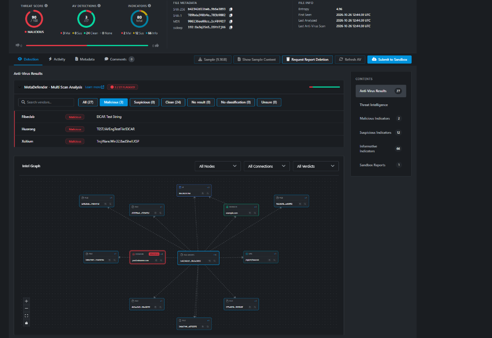

# Security Demo (Console-Only)

A tiny Python walkthrough for demonstrating the *idea* of a security incident
response exercise. It prints fictional events to the terminal and does not
interact with the computer.

## Original scan result

The screenshot below is the original scan result that inspired this
console-only demo. It shows a scan identifying an EICAR test string; the Python
demo in this repository is separate and does not reproduce that file, submit
anything to a scanner, or perform a security test.



## Important

- This is a demo only, not malware and not an antivirus test.
- It does not contain the EICAR test string and cannot verify antivirus
  detection.
- It does not create, read, modify, or delete files.
- It does not access the network, inspect the environment, or execute code from
  memory.

## Run

Requires Python 3. Run:

```text
python demo.py
```

The program prints a short, fictional incident-response walkthrough and exits.
